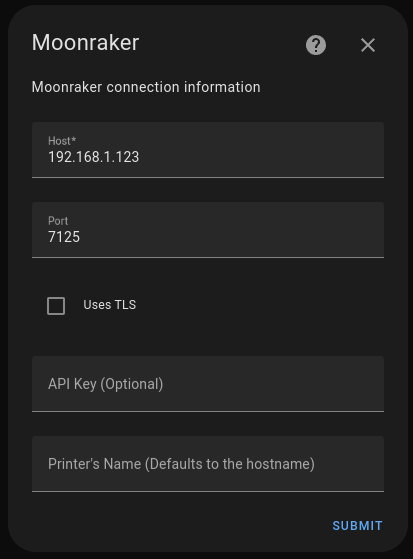

Connection properties
======================

The connection properties dialog can be used to connect to the Moonraker API.
The integration is capable of connecting to most Moonraker deployments.

Connection properties can be defined as follows:

.. list-table:: Connection properties
  :header-rows: 1

  * - name
    - default
    - description
  * - Host
    - None, **(required)**
    - IP address or hostname of Moonraker
  * - Port
    - 7125
    - Moonraker port
  * - Uses TLS
    -
    - use encrypted connections
  * - API Key
    -
    - Moonraker API key
  * - Username
    -
    - Moonraker user, only used to fetch the API key
  * - Password
    -
    - Password of the Moonraker user
  * - Printer's Name
    - Host address
    - Device name in Home Assistant

Note: Encrypted connections must be configured in Moonraker API or by using a
reverse proxy to connect to Moonraker API.

Authentication
-------------------------------------

If Moonraker requires authorization (for example when logins are required in
Fluidd or Mainsail), the integration needs the Moonraker API key.

You can either enter the API key directly, or leave it empty and enter a
Moonraker username and password instead. The integration then logs in once,
fetches the API key and stores only the key. The username and password are not
saved.

When "Uses TLS" is enabled, the login checks Moonraker's certificate, so the
password is never sent to a server that cannot prove its identity. With a
self-signed certificate the login fails: enter the API key directly instead.

With "Uses TLS" enabled, the print thumbnail is also fetched over HTTPS.

If the API key is regenerated in Moonraker, select ``Reconfigure`` on the
printer entry and enter the new key, or clear the API key field and enter the
username and password again.

Polling Rate Configuration
-------------------------------------

It is possible to change the default polling rate value (30 sec) of the integration.

In the integration configuration, you can set the polling rate manually. The
value is in seconds and must be at least 1.

*Too small value may overload your Home Assisant setup and your Moonraker setup.*

While the printer is printing, the integration polls every 2 seconds, or at
the configured rate if that is faster. When the print ends, it goes back to
the configured rate. Each printer uses its own configured rate.

Camera Manual Configuration
-------------------------------------

Camera URL can be manually defined more details in the :ref:`camera_config`

Unreachable Printer
-------------------------------------

If you have your printer turned off by a smart switch or the printer is not reachable, the integration will periodically try to reconnect.
This is not problematic for Home Assistant, but it may create repetitive connection messages in the Home Assistant log file.

In the integration options for the affected printer, enable
``Log unreachable printer connection messages only at DEBUG level``.
When enabled, the integration first checks whether the Moonraker host and port are reachable and avoids starting the websocket client while the endpoint is offline.
This suppresses the normal warning/error noise for intentionally powered-off printers, while DEBUG logging still retains diagnostic information.
If a request fails while the connection still looks open, the endpoint is checked again, so a printer that was just switched off is also handled quietly.
Failures unrelated to reachability are still logged as errors.

Klipper Not Ready
-------------------------------------

Moonraker can be reachable while Klipper is not running, for example when the Moonraker host stays on but the printer board is powered off.
In that case, entities whose data Klipper no longer reports are shown as unavailable until the data comes back.

If Home Assistant starts while Klipper is not ready, Moonraker cannot list the printer objects.
The integration still loads, but entities for those objects (heaters, fans, sensors, output pins, lights, filament sensors) are not created.
Reload the integration once Klipper is ready to add them.

Change IP/Hostname of your printer
-------------------------------------

To change the host, port, TLS setting, API key or printer name of an existing printer,
open ``Settings`` > ``Devices & Services`` > ``Moonraker``, open the menu of the printer
entry and select ``Reconfigure``.

The new settings are validated by connecting to the printer, then the integration is reloaded.
The printer keeps its entities, entity IDs and history, so dashboards and automations keep working.
This also works while the printer is unavailable because its old address no longer answers.

Clearing the printer name makes the integration fall back to the hostname reported by Moonraker.
A name set on the device in Home Assistant always takes precedence over both.
