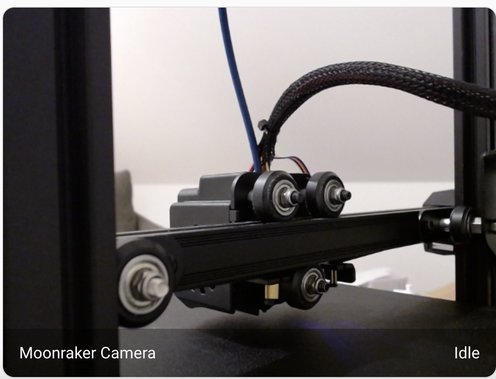
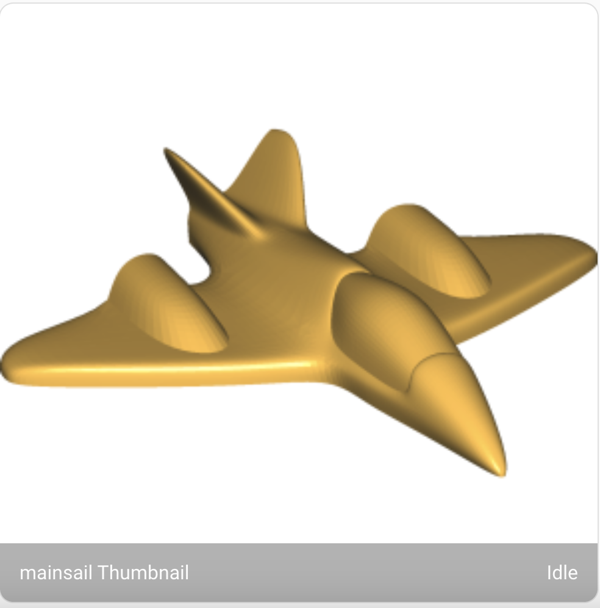

Camera
==========================

* Livestream of any camera configured in crownest. |cam_image|

  * Current issue: Not supporting FLSUN or Creality SonicPad
  * Webcams whose service is not an MJPEG stream (for example ``iframe`` or
    ``webrtc-*``) are shown by refreshing their snapshot URL instead of using the
    stream URL. This also covers the remote screen ("gui" webcam) of the Snapmaker
    U1 extended firmware. Snapshots on the printer use HTTPS when TLS is enabled
    and send the configured API key.

* Thumbnail of the current print. (Your slicer needs to generate the thumbnail image) |thum_image|

  * If the file metadata names a thumbnail that does not exist, and the thumbnail
    is in a folder of its own (``.thumbs/<file>/``), the largest image in that
    folder is shown instead. QIDI firmware does this for ``.gcode.3mf`` plates: it
    saves ``plate_<n>.png`` but always reports ``plate_1.png``.

.. _camera_config:

Manual Configuration
-------------------------------------

It is possible to manually configure the Stream and Snapshot URL for the camera. This will bypass the automatic configuration.

Configuring your camera allows you to either configure a custom URL or use the default configuration but to enforce a different port.

If you configure a custom URL (for the Stream or the Snapshot), the integration will not attempt to connect to the Moonraker API to retrieve the camera URL, this will also ignore the custom port configuration. So use one or the other.

Similarly to the camera, the thumbnail port can be configured.

|config|

.. |config| image:: /_static/config.png

Camera Rotation
-------------------------------------

If you want to rotate the camera image, you can do so by changing the dashboard layout. Using `card mod <https://github.com/thomasloven/lovelace-card-mod>`__.

With the extension installed, just modify your layout yaml. (apply the appropriate rotation (90, 180, 270))

.. code-block:: yaml

    card:
      type: picture-entity
      entity: camera.mkspi_webcam
      camera_view: live
      show_name: false
      show_state: false
      card_mod:
        style: |
          hui-image{
            transform: rotate(-180deg);
          }
